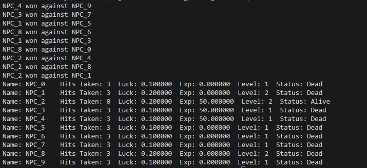

# Coding Assignment 4 - Class Relationships

## Objective
The objective of this lab is to understand pointers, pass by value, and pass by reference in C++.

## Description
This program creates 10 RPG players that fight against each other randomly.

A player loses after taking 3 hits. The winner gains experience and continues to the next round.

The game continues until only one player remains.

## Output

